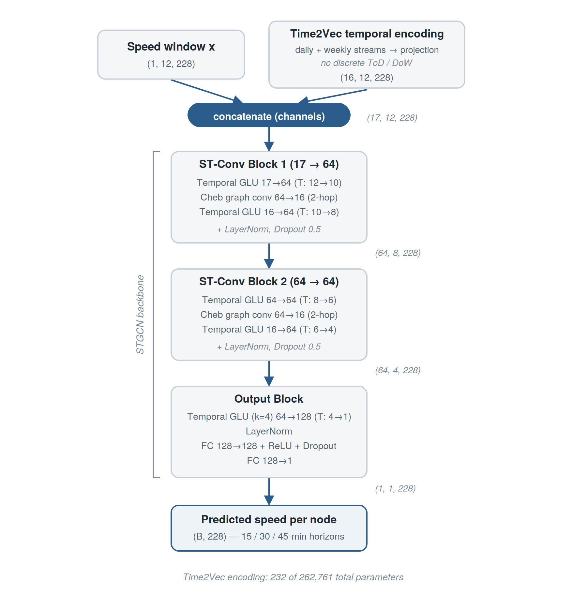
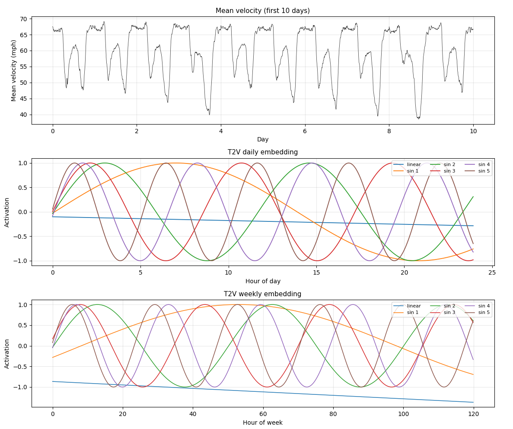
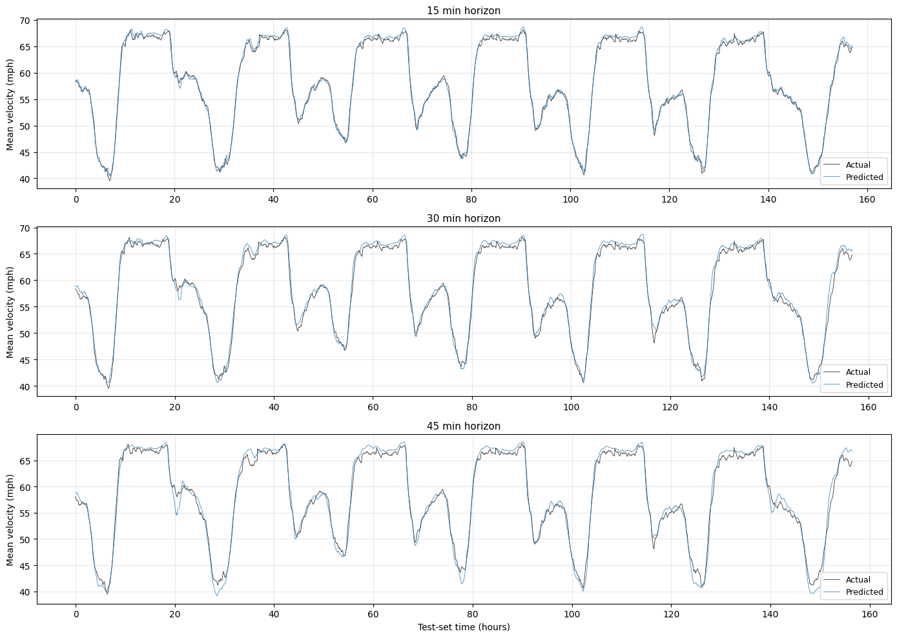

# STGCN + Time2Vec for Traffic Forecasting

**A Time2Vec Temporal Encoding for Multi-Horizon Traffic Forecasting with Spatio-Temporal Graph Neural Networks**.

I explored how daily and weekly time information could help an STGCN predict traffic speeds. The final model takes the previous **60 minutes** of speeds from **228 road sensors** and predicts the speed at each sensor **15, 30, or 45 minutes ahead**.

This repository contains the final model, training code, PeMSD7-M data, and recorded results. **Pretrained checkpoints are not included.**

## Why add Time2Vec?

The STGCN backbone learns how traffic changes over a short observation window and how connected roads affect one another. That window alone does not explicitly tell the model whether it is looking at a weekday morning, an evening rush hour, or a quiet period.

My contribution is a pair of continuous Time2Vec encodings for the time of day and position within the weekday week. Their frequencies start at daily and weekly harmonics, then adjust during training. These features are added to the speed input before it reaches the STGCN.

## Model architecture



*Architecture diagram from my research presentation. Intermediate shapes show channels, time steps, and sensors, with the batch dimension omitted.*

1. **Speed input:** 12 observations at five-minute intervals, with one speed channel per sensor.
2. **Calendar input:** daily and weekly Time2Vec streams, each producing six features: one linear trend and five sinusoids. Their 12 combined features are projected to 16 channels and broadcast across all sensors.
3. **Concatenation:** the speed channel and 16 time channels form an input of shape `[batch, 17, 12, 228]`.
4. **Two ST-Conv blocks:** each combines temporal GLU convolutions with Chebyshev graph convolution, followed by layer normalization and dropout. The graph is fixed and derived from sensor distances. With `Ks=3`, each graph convolution covers the sensor itself and its one- and two-hop neighbors.
5. **Output block:** reduces the remaining time dimension and predicts one future speed per sensor. A separate model is trained for each forecast horizon.

| Stage | Output shape, excluding batch |
|---|---|
| Speed + projected time features | `17 x 12 x 228` |
| ST-Conv block 1 | `64 x 8 x 228` |
| ST-Conv block 2 | `64 x 4 x 228` |
| Output block | `1 x 1 x 228` |

### The temporal encoding

For a normalized time value $\tau$, each stream produces:

$$
e(\tau) = [w_0\tau + b_0,\; \sin(\omega_1\tau + \phi_1),\; \ldots,\; \sin(\omega_5\tau + \phi_5)]
$$

The daily input is `tod / 288`. The weekly input is `(dow * 288 + tod) / (5 * 288)`, because PeMSD7-M records weekdays only. Frequencies are parameterized as:

$$
\omega_k = 2\pi k\,\exp(s_k), \qquad k = 1,\ldots,5
$$

The learned log scales $s_k$ and phases $\phi_k$ start at zero. This starts each stream at 1 through 5 cycles per period while allowing positive frequency adjustments.

The encoding module has **232 parameters**, and the full model has **262,761**. The full increase over the backbone-only model is **7,400 parameters**, since concatenating the time features also widens the first convolution.



*An illustration from the thesis: traffic speeds above, followed by the learned daily and weekly components. The weekly axis spans five weekdays, or 120 hours.*

## Dataset and results

The final experiments use **PeMSD7-M**, with 228 sensors in California's District 7, five-minute speed readings in mph, and 44 weekdays from May-June 2012. Data is split chronologically into **70% training, 15% validation, and 15% test**. Each sensor is standardized using training data only.

The table reports historical test results as **mean +/- sample standard deviation** over seeds `42, 1, 7, 13, 21`.

| Forecast horizon | MAE (mph) | RMSE (mph) | MAPE (%) |
|---|---:|---:|---:|
| 15 minutes | 2.207 +/- 0.018 | 3.951 +/- 0.012 | 5.23 +/- 0.02 |
| 30 minutes | 2.845 +/- 0.048 | 5.233 +/- 0.024 | 7.16 +/- 0.09 |
| 45 minutes | 3.216 +/- 0.115 | 5.911 +/- 0.104 | 8.18 +/- 0.27 |

I tested Time2Vec dimensions `4`, `6`, and `8` at the 15-minute horizon. The selected dimension, `d_t2v=6`, had the lowest mean best-validation loss across seeds. Each run was tested using its best-validation checkpoint.



*Prediction examples from the thesis, averaged across sensors. These are historical single-run illustrations, separate from the five-seed averages in the table.*

The original CSVs and [reproduction notes](results/README.md#reproducing-the-historical-runs) are in [results/](results/README.md). These are recorded research results, not new benchmarks of the cleaned code.

## Run the project

The project was developed with Python 3.12 and PyTorch. Run commands from the directory containing `main.py`.

```powershell
python -m venv .venv
.\.venv\Scripts\Activate.ps1
python -m pip install -r requirements.txt
```

On Linux or macOS, activate the environment with `source .venv/bin/activate`. PyTorch uses CUDA when available and otherwise runs on CPU. For a GPU setup, choose the appropriate build from the [PyTorch installation guide](https://pytorch.org/get-started/locally/).

### Train and evaluate

Train one model for each horizon:

```bash
python main.py --seed 42 --n_pred 3 --save_path h15_s42
python main.py --seed 42 --n_pred 6 --save_path h30_s42
python main.py --seed 42 --n_pred 9 --save_path h45_s42
```

Each command saves a local `.pt` checkpoint and `*_history.csv`, reloads the checkpoint with the lowest validation loss, and prints test metrics. The printed MAPE is a fraction: `0.0523` means `5.23%`. Checkpoints and generated training histories are ignored by Git.

| Training setting | Default |
|---|---|
| Input window / temporal kernel / Chebyshev terms | 12 / 3 / 3 |
| Time2Vec dimension / projected width | 6 per stream / 16 |
| Optimizer / loss | AdamW / MSE in standardized space |
| Learning rate / weight decay | 0.004 / 0.001 |
| Frequency parameters | 10x learning rate, no weight decay |
| Phase parameters | Base learning rate, no weight decay |
| Schedule | Two-epoch warmup, then cosine annealing (`t_max=60`) |
| Batch size / dropout / gradient clipping | 256 / 0.5 / norm 5 |
| Maximum epochs / early-stopping patience | 100 / 10 |

For a backbone-only run, use `--no-temporal_emb`. To repeat a capacity experiment, change `--d_t2v`:

```bash
python main.py --no-temporal_emb --save_path baseline_s42
python main.py --d_t2v 4 --save_path capacity4_s42
```

### Inspect Time2Vec

```bash
python inspect_temporal.py --ckpt h15_s42.pt
```

This prints learned frequencies, phases, and trend coefficients and exports CSVs to `runs/temporal_encoding/`. The existing [temporal_encoding/](temporal_encoding/) files are historical exports from the 15-minute seed-7 model, not complete model weights.

## Limitations

The final study covers one benchmark and a weekday-only calendar. The time encoding is shared by every sensor, so it does not model sensor-specific timing shifts. Cross-dataset evaluation and node-specific temporal features are directions for further work. The thesis also compares with published STGCN results; that comparison is not a matched rerun under this final training recipe.

The historical pipeline has CSV-header and window-boundary quirks, and the cleaned implementation consumes random numbers differently from the original notebooks. See the [reproduction notes](results/README.md#reproducing-the-historical-runs) before trying to reproduce an exact metric row.

## Files

```text
main.py                 Training and evaluation
model/                  STGCN layers and Time2Vec encoding
script/                 Data loading, graph operators, metrics, early stopping
data/pemsd7-m/          Speed matrix and fixed adjacency
results/                Original result tables and reproduction notes
assets/figures/         Figures from the thesis and presentation
temporal_encoding/      Historical encoding-parameter exports
inspect_temporal.py     Temporal-parameter inspection tool
requirements.txt        Python dependencies
```

## Credits

The STGCN backbone, graph operators, and data-loading code are adapted from [hazdzz/STGCN](https://github.com/hazdzz/STGCN), whose [upstream license is LGPL 2.1](https://github.com/hazdzz/STGCN/blob/main/LICENSE). My research adds the daily/weekly Time2Vec encoding, harmonic initialization, frequency reparameterization, training configuration, and analysis utilities.

- Yu, Yin, and Zhu, [Spatio-Temporal Graph Convolutional Networks: A Deep Learning Framework for Traffic Forecasting](https://arxiv.org/abs/1709.04875), IJCAI 2018.
- Kazemi et al., [Time2Vec: Learning a Vector Representation of Time](https://arxiv.org/abs/1907.05321), 2019.
- PeMSD7-M data was carried forward from the reference implementation and the [original STGCN data distribution](https://github.com/VeritasYin/STGCN_IJCAI-18/blob/master/data_loader/PeMS-M.zip). The upstream software license does not establish separate licensing terms for the dataset.
